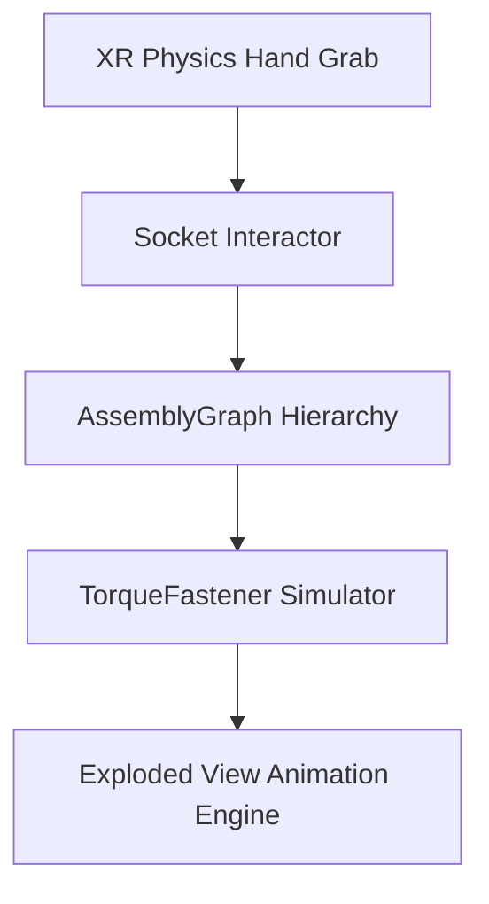

# mechanic-sim-xr

Interactive automotive and machinery maintenance simulator supporting VR headsets and lightweight browser WebGL.

## Features

- **Dependency Graph Sequencing**: Enforces strict manufacturer service sequences (e.g., valve cover before camshaft removal).
- **Realistic Torque Simulation**: Haptic feedback on simulated torque wrenches with nominal tolerance verification.
- **Dual Runtime Target**: High-end OpenXR VR (Quest / Vive) or sub-25MB WebGL browser deployment.

## License

MIT License (c) 2023-2026 Gaurav Bhardwaj / OmegaGaze Lab.
